<h2 align="center">Hi there, I'm Emil (he/him) 👋</h2>

  
  

  

### 🚀 Side project

<table>
  <tr>
    <th align="left">📦 Project</th>
    <th align="left">🧰 Tech stack</th>
  </tr>
  <tr>
    <td>🧠 <a href="https://github.com/emilirgi18/MindMap"><b>MindMap</b></a>: a shared notes workspace with live collaborative markdown editing, a 3D graph of linked notes and a kanban board (<a href="https://mind-map-woad-sigma.vercel.app">demo</a>)</td>
    <td>        </td>
  </tr>
</table>

### 🏢 At Komune Studio

Client work lives in private repos, so there are no links.

<table>
  <tr>
    <th align="left">🛠️ Project and my part</th>
    <th align="left">🧰 Tech stack</th>
  </tr>
  <tr>
    <td>🎓 <b>Education marketplace app</b>: courses, class booking and chat 👷 iOS & Android app, backend and admin dashboard</td>
    <td>     </td>
  </tr>
  <tr>
    <td>🪙 <b>Loyalty rewards platform</b>: points, rewards and referrals 👷 Backend, customer and admin apps</td>
    <td>     </td>
  </tr>
  <tr>
    <td>🏎️ <b>Go-kart racing platform</b>: tournaments, championship points and referrals 👷 API, admin dashboard and mobile app</td>
    <td>     </td>
  </tr>
  <tr>
    <td>📱 <b>Mobile apps</b>: for institutional and immigration-services clients 👷 Apps and their backends</td>
    <td>   </td>
  </tr>
  <tr>
    <td>🌐 <b>Websites and dashboards</b>: company sites, event registration and admin panels 👷 Front end, and the back end on most</td>
    <td>    </td>
  </tr>
</table>

### 🧰 Toolbox

<table>
  <tr>
    <td>💬 <b>Languages</b></td>
    <td>  </td>
  </tr>
  <tr>
    <td>🎨 <b>Front end</b></td>
    <td>      </td>
  </tr>
  <tr>
    <td>📱 <b>Mobile</b></td>
    <td> </td>
  </tr>
  <tr>
    <td>⚙️ <b>Back end</b></td>
    <td>  </td>
  </tr>
  <tr>
    <td>🗄️ <b>Data</b></td>
    <td>   </td>
  </tr>
  <tr>
    <td>☁️ <b>Cloud and tools</b></td>
    <td> </td>
  </tr>
</table>

### 📫 Find me elsewhere

- 🌐 [irgi.eu](https://irgi.eu) — about me, projects, blog and TTRPG stuff
- 💼 [LinkedIn](https://www.linkedin.com/in/emil-irgi-fathurachmat/)
- 📸 [Instagram: @emilirgi](https://www.instagram.com/emilirgi/)
- 📺 [YouTube: @emilirgi18](https://www.youtube.com/@emilirgi18)
